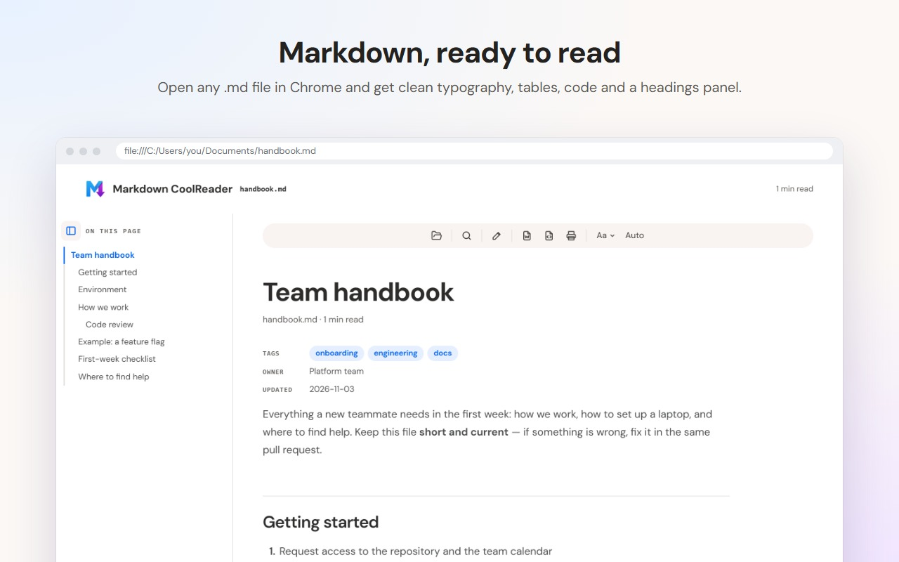

# Markdown CoolReader

A Chrome extension that opens Markdown files formatted for reading, instead of raw text.



## Features

- Clean typography for headings, lists, quotes, tables and code, with syntax highlighting
- Headings panel on the left that follows where you read
- Light, dark or automatic theme; text size, width and font
- Search with Ctrl+K, F3 to step through matches
- Links between `.md` files, Obsidian-style `[[wikilinks]]`, images stored next to the file
- Edit on the formatted page and save the `.md` (untouched parts are kept byte for byte)
- Show the original Markdown text, and back to the formatted page, from the toolbar
- Export to Word (`.docx`), to a self-contained web page (`.html`), or print to PDF

## Use it

1. Install the extension.
2. In `chrome://extensions` › Markdown CoolReader › Details, turn on **Allow access to file URLs**.
3. Open a `.md` file in Chrome (drag it in, or Ctrl+O).

Without step 2, the toolbar icon opens the reader on its own page: choose a file or a folder, or drop it there.

Optional: from the settings page (it opens at install, and from the reader's drop screen), allow websites to also format `.md` files served as plain text, such as raw files on GitHub.

## Privacy

Nothing leaves your computer: no server, no account, no analytics. See [PRIVACY.md](PRIVACY.md).

## Development

```bash
npm install          # also copies DOMPurify and highlight.js into vendor/
npm test             # end-to-end tests in Playwright's Chromium
npm run assets       # icons and Chrome Web Store images
npm run package      # dist/markdown-coolreader-<version>.zip
npm run sync-reader  # update reader/ from the MuchoTools Markdown Reader
```

Load the folder as an unpacked extension in `chrome://extensions` (Developer mode).

The reader in `reader/` comes from the MuchoTools Markdown Reader; `src/` adapts it to files opened in Chrome. Third-party licenses: [THIRD_PARTY_NOTICES.txt](THIRD_PARTY_NOTICES.txt).
